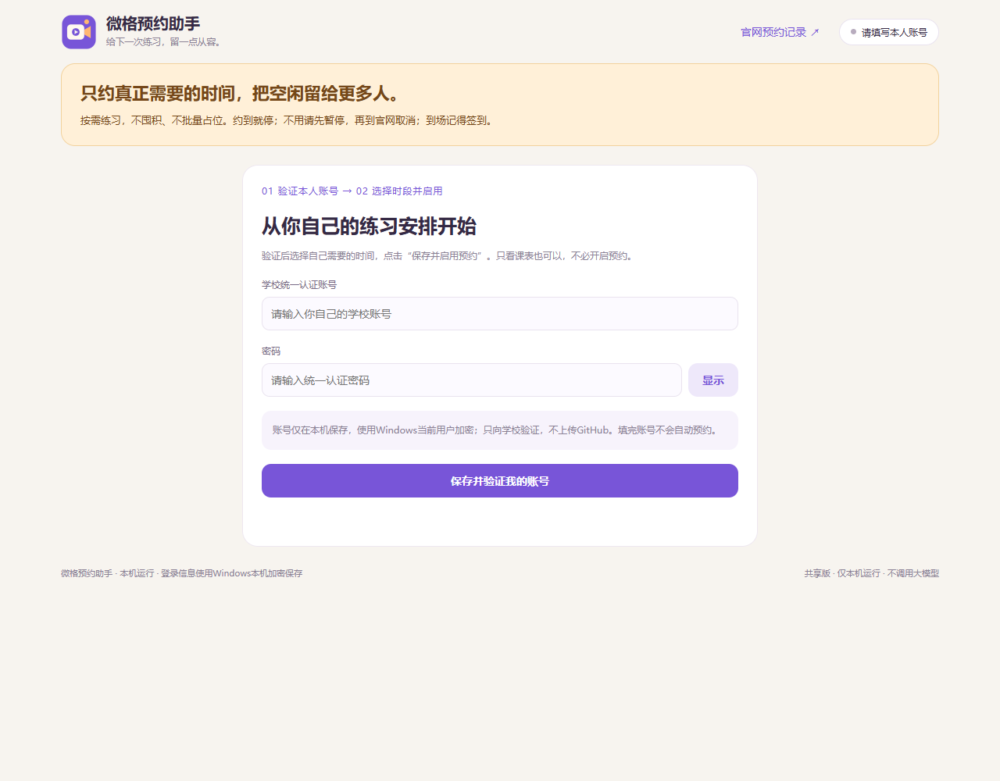

# 微格教室预约助手

> **只约真正需要的时间，把空闲留给更多人。**

面向有微格练习需要的华南师范大学同学，欢迎同门、师兄师姐、师弟师妹按需使用、分享。发现空闲教室、安排个人练习；请勿囤积课室、批量占位或预约过长时间。

**[下载 Windows 版 ZIP](https://github.com/BoxunYang/scnu-micro-room/releases/latest/download/scnu-micro-room-windows.zip)** · 支持 Windows 10/11

## 开始使用

1. 下载后**全部解压**到一个长期保留的文件夹，双击 **`打开预约助手.cmd`**。首次会自动准备运行环境，并创建桌面快捷方式。
2. 在打开的页面填写**本人的学校统一认证账号、密码**，点击验证。
3. 选择校区、日期、上午／下午／晚上，点击**“保存并启用预约”**。以后双击桌面“微格预约助手（共享版）”即可。

只想看空位，验证账号后直接进入“课室课表”即可，无须启用预约。首次默认只约指定一天，约到后自动暂停；填写账号不会自动提交预约。

## 使用时记住这几件事

- 电脑须开机、联网，保持当前 Windows 用户登录。关闭网页后后台继续运行，关机或断网时无法预约。
- 同一教室连续两段优先；下午先找15:00后的组合。预约成功后右下角静音提醒，不发声、不抢焦点。
- 放号后持续尝试20分钟；之后至午夜每5分钟查余位，白天09:00—18:00每10分钟检查。遇到限流会退避，已有目标日期预约就跳过。
- **临时不用：先暂停助手，再到[官网预约记录](https://tstc.scnu.edu.cn/#/appointment-record)取消。**按[学校公告](https://tstc.scnu.edu.cn/#/notice/preview?id=8)到场签到，预约开始后10分钟内完成；连续预约首节缺席会影响后续节次。

这是非官方本地工具，不保证预约成功，不绕过学校限额、验证码或限流。登录或课表异常时请暂停并核对官网。

账号与隐私

- 每人在自己的电脑填写自己的账号。密码与会话由 Windows 当前用户 DPAPI 加密，只用于向学校验证，不上传 GitHub。
- 本机数据位于 `%LOCALAPPDATA%\SCNU-MicroRoom-Community`；不要分享该目录，也不要共用 Windows 账号。下载包不含开发者的账号、预约记录或观察名单。
- 课表仅显示学校返回的姓名；七天姓名观察默认关闭，主动开启后数据也只留在本机。同名不能证明同一人、违规或实际到场。
- 不调用大模型，不需要 OpenAI/Codex，不消耗其 token。反馈问题前请去掉密码、token、个人记录和姓名观察数据。

运行环境与开发

首次启动需要联网；脚本优先使用本机 Node.js 22+，否则从 Node.js 官方下载24 LTS并核验 SHA-256。出现下载失败时，安装 [Node.js LTS](https://nodejs.org/en/download)后重新打开即可。请保留解压后的文件夹，桌面快捷方式依赖它。

本机面板：`http://127.0.0.1:8912/`。开发者可运行 `npm start`；`npm test` 使用虚拟账号与模拟响应，不提交真实预约。无需安装 npm 依赖。

